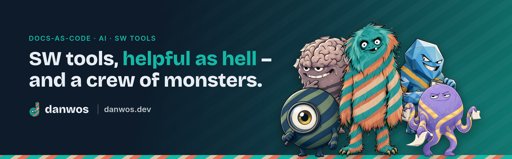

I'm Daniel. I build SW tools that help large engineering teams keep their knowledge, their quality and their decisions under control. Before danwos, I founded useblocks and built Sphinx-Needs and other docs-as-code tools with my team.

- **[monsterbrain](https://monsterbrain.danwos.dev)** – a brain for people and AI agents: knowledge, concepts and results in one clear folder structure
- **[deciwa](https://deciwa.danwos.dev)** – feedback and approvals right on your docs, websites and code
- **quawa** – checks whether the tests of AI-written code really test
- **faktwerk** – maintain knowledge once and show it the right way for every role

More at [danwos.dev](https://danwos.dev).
